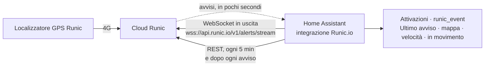

🇬🇧 [Read in English](README.md)

# Runic.io per Home Assistant

Integrazione personalizzata per i localizzatori GPS [Runic.io](https://www.runic.io).

- I **veicoli** vengono letti dall'API REST di Runic (`https://api.runic.io/v1`, token Bearer) ogni 5 minuti
  e subito dopo ogni avviso. Per ogni veicolo ottieni:
  - `device_tracker.<veicolo>`: la posizione sulla mappa.
  - `sensor.<veicolo>_speed`: la velocità GPS dell'ultima rilevazione, in km/h.
  - `binary_sensor.<veicolo>_moving`: acceso quando l'ultima rilevazione ha meno di 15 minuti ed è a 5 km/h o più.
    Lo stato `RUN`/`STOP` di Runic viene conservato solo come attributo `runic_status`: indica `RUN` ogni volta
    che il localizzatore è attivo (heartbeat, accensione), anche quando il veicolo è parcheggiato.
- Gli **avvisi** arrivano in pochi secondi tramite lo **stream in tempo reale** di Runic: Home Assistant apre
  una WebSocket in uscita, quindi non servono URL pubblici, port forwarding o Nabu Casa. Ogni avviso diventa
  un'attivazione del dispositivo e un `runic_event`. I webhook firmati sono ancora supportati, da soli o insieme
  allo stream. Dopo una disconnessione lo stream riprende da dove si era fermato (Runic conserva 72 ore) e i
  duplicati vengono scartati.

## Installazione

### HACS (consigliato)

[](https://my.home-assistant.io/redirect/hacs_repository/?owner=martineo14&repository=ha-runic&category=integration)

Oppure in HACS → ⋮ → **Repository personalizzati**, aggiungi `https://github.com/martineo14/ha-runic` come *Integrazione*,
poi scarica **Runic.io** e riavvia Home Assistant.

### Manuale

Copia `custom_components/runic` nella cartella `config/custom_components/` di HA e riavvia.

### Configurazione

1. Nel [portale Runic](https://developers.runic.io/portal/webhooks): **Add endpoint** → **Real-time stream**,
   e seleziona i tipi di avviso che vuoi. Uno stream per azienda; non c'è nessun URL o segreto da copiare.
2. In Home Assistant: Impostazioni → Dispositivi e servizi → Aggiungi integrazione → **Runic.io**.
3. Incolla il tuo token API (rilasciato dal supporto Runic, runic@runic.io), poi scegli **Stream in tempo reale**.
4. Provalo: premi **Send test event** sull'endpoint dello stream nel portale. In Strumenti per sviluppatori →
   Eventi, in ascolto su `runic_event`, compare un `alert.test`.

Il sensore **Stream avvisi** sul dispositivo *Runic.io* indica se lo stream è collegato.
Se Runic revoca o fa scadere il token, Home Assistant ti chiede un token nuovo.

**Con un webhook invece:** scegli **Webhook** al passo 3, aggiungi nel portale l'URL mostrato da Home Assistant
come endpoint webhook e incolla il segreto di firma `whsec_…`. In questo caso Home Assistant deve essere
raggiungibile da internet in HTTPS (Nabu Casa, Cloudflare Tunnel, reverse proxy) e l'URL non deve fare redirect.
Un'integrazione configurata con webhook prima della 0.5.0 lo mantiene: attiva lo stream da **Runic.io → Configura**.

## Pagina del veicolo

Ogni veicolo è un dispositivo. La sua pagina in Impostazioni → Dispositivi e servizi mostra, in base a cosa invia il localizzatore:

| Come nella pagina Runic | Entità |
|---|---|
| In marcia / parcheggiato, ultimo rilevamento | `sensor.<veicolo>_stato` (In marcia, Parcheggiato, Non raggiungibile), `sensor.<veicolo>_ultimo_rilevamento` |
| Mappa e coordinate | `device_tracker.<veicolo>` |
| Oggi: distanza, guida, viaggi, sosta | `sensor.<veicolo>_distanza_oggi`, `_tempo_di_guida_oggi`, `_viaggi_oggi`, `_tempo_in_sosta_oggi` (ogni 15 minuti, ripartono da zero ogni giorno) |
| Chilometri, ore motore | `sensor.<veicolo>_contachilometri`, `sensor.<veicolo>_ore_motore` |
| Scadenza tagliando | `sensor.<veicolo>_prossimo_tagliando`, impostato dall'avviso di manutenzione di Runic, con l'intervento come attributo |
| Dove si trova | `sensor.<veicolo>_punto_di_interesse`: il punto di interesse Runic in cui si trova, per nome, oppure *Fuori* |
| Dal localizzatore, se collegati | quadro acceso, motore, immobilizzatore, porte (ogni porta come attributo), temperatura e umidità del vano di carico, carburante consumato; ingressi digitali (disattivati di default, attivali per ogni veicolo) |
| Inoltre | velocità, in movimento, tensione batteria, livello carburante, ultimo avviso; segnale GSM (diagnostica, disattivato di default) |

La pagina del dispositivo mostra anche la targa (come numero di serie), il firmware del localizzatore e un link
**Visita** al portale Runic. I sensori compaiono solo per i valori che il veicolo invia: un'auto senza dati
carburante CAN non ha il sensore del carburante.
I veicoli aggiunti al tuo account Runic, e i valori che un localizzatore inizia a inviare in seguito, compaiono
al prossimo aggiornamento (entro 5 minuti), senza ricaricare l'integrazione. Se rinomini un veicolo o ne cambi la targa
in Runic, si aggiorna anche il dispositivo (un nome che hai impostato tu in Home Assistant resta). Un veicolo rimosso da
Runic viene rimosso da Home Assistant dopo due aggiornamenti di fila senza di lui (circa 10 minuti), così un errore
momentaneo non cancella nulla; puoi anche eliminarlo subito dalla pagina del dispositivo. Le scadenze di assicurazione e revisione non sono nell'API di Runic,
quindi non si possono mostrare.

**Una plancia in stile Runic:** [`docs/vehicle-dashboard-it.yaml`](docs/vehicle-dashboard-it.yaml) ricrea la pagina
con le schede integrate: nome con lo stato, una grande mappa con il percorso di oggi, i blocchi Oggi e Veicolo,
il prossimo tagliando e gli ultimi avvisi. Crea una plancia, poi ⋮ → Modifica plancia → ⋮ → Editor di configurazione
testuale, incolla il file e sostituisci `furgone_12` con il nome entità del tuo veicolo.

Gli id delle entità seguono la lingua di Home Assistant al momento in cui aggiungi l'integrazione: in italiano sono
`sensor.<veicolo>_velocita`, `_stato`, `_distanza_oggi`…; in inglese `_speed`, `_status`, `_distance_today`….

## Punti di interesse e zone

Gli avvisi di geofence riportano il **nome** del punto di interesse: usa `{{ trigger.event.data.poi_name }}` nei
messaggi e nelle condizioni, ad esempio `{{ trigger.event.data.poi_name == 'Magazzino' }}`, invece di un id numerico.

**Sincronizza le zone di Home Assistant con Runic** (Runic.io → Configura): ogni zona di Home Assistant, tranne
quelle passive, diventa un punto di interesse Runic con lo stesso nome, posizione e raggio (Runic accetta da 50 m
a 50 km). Spostando, ridimensionando, rinominando o eliminando una zona, Runic si aggiorna entro 30 secondi;
l'azione `runic.sync_zones` sincronizza subito. Se nella stessa schermata aggiungi un'email, crea anche le regole
di avviso di entrata e uscita per tutti i veicoli, perché Runic richiede un'email per ogni regola.
Modifica solo i punti di interesse che ha creato (il loro indirizzo è *Home Assistant zone zone.…*);
quelli disegnati nell'app Runic non vengono toccati.

## Come funziona



Home Assistant apre solo connessioni **in uscita**: funziona dietro qualsiasi router o connessione 4G,
senza esporre nulla su internet.

| Connessione | Cosa trasporta | Quando |
|---|---|---|
| **Stream avvisi** (WebSocket, token Bearer) | Tutti i tipi di avviso selezionati sull'endpoint stream | Pochi secondi dopo che Runic li genera |
| **API REST** (`GET /vehicles`, `GET /vehicles/{id}`) | Posizione, velocità e stato di ogni veicolo | Ogni 5 minuti e subito dopo ogni avviso |
| **Webhook** (facoltativo, firmato) | Gli stessi avvisi, se preferisci che Runic chiami Home Assistant | Richiede Home Assistant raggiungibile in HTTPS pubblico |

**Affidabilità**

- L'integrazione ricorda l'ultimo avviso elaborato (il suo `seq`), anche dopo un riavvio. Dopo una
  disconnessione riprende da lì; Runic conserva 72 ore di avvisi. Dopo un'interruzione più lunga aggiorna
  invece i veicoli tramite l'API REST.
- La consegna è "almeno una volta": gli avvisi ripetuti vengono scartati in base al loro `id`, quindi
  stream e webhook possono funzionare anche insieme senza attivazioni doppie.
- Le connessioni cadute (aggiornamenti di Runic, cambi di rete) si ricollegano da sole: dopo 1 s, poi il
  doppio ogni volta fino a 5 minuti, con un ritardo casuale. Invia il `ping` richiesto da Runic ogni 30 s.
- Se Runic revoca o fa scadere il token, lo stream si ferma e la scheda Runic.io in
  Impostazioni → Dispositivi e servizi chiede un nuovo token.

**Privacy:** il token API è salvato nella configurazione di Home Assistant come le credenziali di qualsiasi
altra integrazione, e viene inviato solo ad `api.runic.io`. Avvisi e posizioni restano nel tuo Home Assistant.

## Automazioni

### Dall'editor delle automazioni

Ogni veicolo ha un'attivazione per ogni tipo di avviso Runic. Aggiungi attivazione → **Per destinazione** (By target) → scegli il veicolo
(per esempio *Camion 3*) → scegli l'avviso: *Allarme furto*, *Partito*, *Entrato in un punto di interesse*,
*Uscito da un punto di interesse*, *Limite di velocità superato*, *Batteria del veicolo scarica*… Oppure usa **Dispositivo** → il veicolo → l'avviso.

Ogni veicolo ha anche un'entità `event.<veicolo>_last_alert` (*Ultimo avviso*) che mostra il suo avviso più recente nella dashboard,
nella cronologia e nel registro.

Un tipo di avviso scatta solo se in Runic sono configurate due cose: il tipo è selezionato sul tuo endpoint stream
o webhook (developers.runic.io → Webhooks) ed esiste una regola di avviso per quel tipo nell'app Runic.

### In YAML

```yaml
triggers:
  - trigger: event
    event_type: runic_event
    event_data:
      type: alert.poi_area
actions:
  - action: notify.mobile_app_phone
    data:
      message: >
        {{ trigger.event.data.vehicle_name }}
        {{ 'è arrivato al' if trigger.event.data.data.direction == 'in' else 'ha lasciato il' }}
        punto di interesse {{ trigger.event.data.data.poi_id }}
```

Dati dell'evento: `id`, `type`, `alert` (il tipo senza `alert.`), `device_id`, `direction` (geofence), `level`, `created_at`, `vehicle_id`, `vehicle_name`, `plate`,
`position` (`lat`, `lon`, `at`), `data` (specifici del tipo), `message`.

Tipi di avviso: `alert.movement`, `alert.poi_area`, `alert.speed_limit`, `alert.theft`, `alert.tow`,
`alert.parking_moved`, `alert.panic_button`, `alert.accident`, `alert.jamming`, `alert.cable_cut`,
`alert.tamper`, `alert.input_activation`, `alert.device_alarm`, `alert.low_battery`,
`alert.low_battery_internal`, `alert.offline`, `alert.fuel`, `alert.fuel_tank`, `alert.maintenance`,
`alert.test`. Un avviso scatta solo se esiste una regola di avviso per quel tipo nell'app Runic.

## Sviluppo

```bash
python -m venv .venv && .venv/bin/pip install pytest-homeassistant-custom-component
.venv/bin/pytest
```
